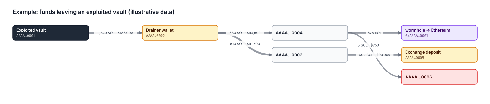

<p align="center">
  <picture>
    <source media="(prefers-color-scheme: dark)" srcset="docs/assets/hero-dark.svg">
    
  </picture>
</p>

<h3 align="center">Give your AI agent a Solana forensics lab.</h3>

<p align="center">
  Trace stolen funds across hops and bridges, unmask wallet clusters run by one operator and screen tokens for rug risk, straight from a chat with Claude or any <a href="https://modelcontextprotocol.io">MCP</a> client. Read-only, powered by <a href="https://www.helius.dev">Helius</a>.
</p>

<p align="center">
  <a href="https://github.com/dennisyilmaz/coin-scout/actions/workflows/ci.yml"></a>
  <a href="https://github.com/dennisyilmaz/coin-scout/releases/latest"></a>
  <a href="https://scorecard.dev/viewer/?uri=github.com/dennisyilmaz/coin-scout"></a>
  <a href="LICENSE"></a>
</p>

<p align="center">
  <a href="#install"><b>Install</b></a> ·
  <a href="#what-it-can-do"><b>What it can do</b></a> ·
  <a href="#how-it-works"><b>How it works</b></a> ·
  <a href="#tools"><b>Tools</b></a> ·
  <a href="#data-and-privacy"><b>Privacy</b></a>
</p>

<p align="center">
  
</p>
<p align="center"><sub>Numbers from a real <code>analyze_token</code> run on BONK, 5 November 2026.</sub></p>

## What it can do

- **Follow the money.** `trace_funds` walks transfers forward or backward up to 5 hops, values every edge in USD at the moment it moved, and stops at Wormhole, deBridge and Mayan crossings to tell you which chain and address the funds landed on.
- **Find the operator.** `find_cluster` mines fee payers, co-signers, rent destinations, shared funders and same-slot activity to surface wallets one actor controls, with the signatures behind every link.
- **Screen before you buy.** `analyze_token` checks mint and freeze authority, metadata mutability and holder concentration, and tells pools and other program-controlled holders apart from real whales.
- **See who profited.** `wallet_pnl` prices every swap at the time it happened and flags sales of tokens the wallet never bought.
- **Build a case.** Save traces and clusters to case files, label addresses with confidence and evidence, and export a Markdown report with SVG fund-flow diagrams.
- **Can't touch your money.** No keys, no signing. The raw RPC tool forwards only read methods, so `sendTransaction`, `requestAirdrop` and friends never reach the network. The only thing it writes is your local case files.

Try asking:

- *"Profile wallet `<address>`: who funded it, where did its money go, anything suspicious?"*
- *"Is `<mint>` a rug risk? Who actually holds the supply?"*
- *"Trace funds out of `<address>` for 3 hops, save it to case `exchange-hack`, then export the report."*
- *"Are these four wallets the same person?"*
- *"Did `<wallet>` profit from `<mint>`, and who sent it tokens for free?"*

## Install

You need a Helius API key (the free tier works) and Node.js 22.19 or newer. coin-scout speaks the **2026-07-28** MCP revision over stdio and Streamable HTTP, still serves 2025-era clients, and is listed in the official MCP Registry as `io.github.dennisyilmaz/coin-scout`.

### Claude Desktop and other MCPB clients

<a href="https://github.com/dennisyilmaz/coin-scout/releases/latest/download/coin-scout.mcpb"></a>

Open the downloaded `coin-scout.mcpb` with your client and paste your Helius API key when asked. The key is stored by the client, not in the bundle.

### Claude Code

```bash
curl -LO https://github.com/dennisyilmaz/coin-scout/releases/latest/download/coin-scout.mjs
node coin-scout.mjs
```

The single file is the whole server. Run interactively, it asks for your Helius key, copies itself to `~/.coin-scout/` and registers itself with `claude mcp add` at user scope. Restart Claude Code and the tools are there.

### Any MCP client, from source

```bash
git clone https://github.com/dennisyilmaz/coin-scout.git && cd coin-scout
npm ci && npm run build
```

```json
{
  "mcpServers": {
    "coin-scout": {
      "command": "node",
      "args": ["/absolute/path/to/coin-scout/build/index.js"],
      "env": { "HELIUS_API_KEY": "your-key" }
    }
  }
}
```

For Streamable HTTP instead of stdio, run `node build/http.js`. It binds `127.0.0.1:8787` only, rejects foreign `Host` headers, and serves `GET /health` with transport metrics.

### Verify a download

Every release is built in GitHub Actions with signed build provenance, and ships a `SHA256SUMS` file and a CycloneDX SBOM (`coin-scout.cdx.json`).

```bash
gh attestation verify coin-scout.mjs --repo dennisyilmaz/coin-scout
```

## How it works

<p align="center">
  <picture>
    <source media="(prefers-color-scheme: dark)" srcset="docs/assets/how-it-works-dark.svg">
    
  </picture>
</p>

Helius bills and rate-limits **per RPC call**, not per HTTP request, so raw parallelism just buys you 429s. The transport layer is built around that:

- **JSON-RPC micro-batching.** Calls issued within a 4 ms window are coalesced into one HTTP request. Measured on a 50-call `getTransaction` fan-out: **8 HTTP requests instead of 50, 2.2x faster wall clock.**
- **Adaptive batch sizing.** A batch that gets 429'd is halved and the un-answered calls are requeued rather than failed; the size grows back on sustained success. Empirically the API accepts batches of 20 but rejects 50.
- **Cost-aware adaptive rate limiting.** Request spacing scales with the *number of calls* in a request, so a 20-call batch is spaced like 20 calls. Concurrency halves and spacing doubles on each 429, then decay back. `server_metrics` reports the converged rate.
- **HTTP/2 + keep-alive** over an `undici` pool, so there is no TLS handshake per call.
- **Two-tier TTL cache with in-flight coalescing.** Finalized transactions and blocks cache for hours; balances for seconds. Concurrent identical calls share one promise.
- **Narrow payloads.** Tools return one compact JSON document rather than raw node responses. The biggest lever on agent latency is tokens, not milliseconds.

## Tools

### Analysis (composite, start here)

| Tool | What it answers |
| --- | --- |
| `analyze_wallet` | Portfolio value, holdings, wallet age, in/out flow shape, top counterparties, earliest funders, risk flags |
| `analyze_token` | Rug screen: live mint/freeze authority, metadata mutability, supply, FDV, holder concentration (top1 / top10 / HHI) with pools and other program-controlled holders flagged, 0-100 risk score |
| `trace_funds` | BFS fund-flow graph, forward or backward, up to 5 hops: nodes, weighted edges valued in USD at the time of each transfer, terminal sinks, circular flows. Stops at bridges and reports where the funds went |
| `follow_bridge` | Funds that left or entered Solana via Wormhole, deBridge or Mayan: other chain, recipient, amounts, destination-chain tx. Takes signatures, or an address to scan |
| `find_cluster` | From one wallet, discovers likely co-controlled wallets: fee payers, co-signers, rent destinations, shared or sole funders, same-slot activity, creation time. Scored, with signature evidence |
| `wallet_pnl` | Realized and unrealized PnL per token from swaps, priced at swap time. Flags sales of tokens never bought and, for one mint, who sent the tokens for free |
| `find_counterparties` | Every address a wallet transacted with, ranked, split by direction and per-mint volume |
| `compare_wallets` | Sybil / co-ownership test across 2-10 wallets: direct links, shared funders, counterparty Jaccard overlap, 0-100 link strength |
| `investigate_transaction` | One signature: enhanced parse, per-account balance deltas with USD at the time, rug screen on every mint involved, fee-payer profile |

### Case files

| Tool | What it does |
| --- | --- |
| `case_update` | Create a case or add a summary, address labels (with confidence and evidence signatures) and dated notes |
| `case_read` | List cases, read one, or search every case for an address before starting on it |
| `case_export` | Write `report.md` with Mermaid diagrams plus one standalone SVG fund-flow diagram per saved trace or cluster |

Pass `case: "<name>"` to `trace_funds`, `find_cluster` or `follow_bridge` to save the result into that case. Labels from any case show up in every tool's `label` field, so later investigations build on earlier ones. Cases live in `~/.coin-scout/cases/<name>/` as plain JSON.

<p align="center">
  
</p>
<p align="center"><sub>A <code>case_export</code> diagram, drawn by coin-scout's own renderer. Illustrative data.</sub></p>

### Data access

| Tool | Backed by |
| --- | --- |
| `chain_status` | `getEpochInfo` + `getPriorityFeeEstimate` |
| `get_balances` | DAS `getAssetsByOwner` with native balance and USD pricing |
| `get_account` | `getMultipleAccounts` (jsonParsed) with program labelling |
| `get_transactions` | Helius Enhanced Transactions: human-readable type, source, transfers, swap events |
| `get_transaction_raw` | `getTransaction` with logs, inner instructions, compute units |
| `get_transfers` | `getTransfersByAddress`: server-side counterparty / direction / mint / time filters, optional USD at the time of each transfer |
| `get_transaction_history` | `getTransactionsForAddress`: slot, time and status filters with cursor paging |
| `get_swaps` | Enhanced history filtered to `SWAP`, normalised into sold/bought legs plus a per-mint net summary |
| `get_token_holders` | DAS `getTokenAccounts` |
| `get_assets` / `search_assets` / `get_asset_activity` | Full DAS surface (NFTs, cNFTs, fungibles, Token-2022) |
| `solana_rpc` | Escape hatch for read-only RPC and DAS methods: `get*`, `is*`, `search*`, `minimumLedgerSlot`, `simulateTransaction` |
| `server_metrics` | Batch compression, cache hit rate, adaptive rate-limit state |

### Prompts

`investigate_address`, `screen_token`, `trace_stolen_funds`: each encodes an investigation order of operations.

## Configuration

All optional except the API key. See `.env.example`.

| Variable | Default | Purpose |
| --- | --- | --- |
| `HELIUS_API_KEY` | — | Required |
| `HELIUS_NETWORK` | `mainnet` | `mainnet` or `devnet` |
| `HELIUS_RPC_HOST` | `<network>.helius-rpc.com` | Override the RPC host |
| `HELIUS_MAX_CONCURRENCY` | 24 | Ceiling on in-flight HTTP requests |
| `HELIUS_CONNECTIONS` | 64 | `undici` pool size |
| `HELIUS_MAX_BATCH_SIZE` | 20 | Upper bound for JSON-RPC batching |
| `HELIUS_BATCH_WINDOW_MS` | 4 | Coalescing window |
| `HELIUS_HTTP2` | true | Disable to force HTTP/1.1 |
| `HELIUS_TIMEOUT_MS` | 30000 | Per-request timeout |
| `HELIUS_MAX_RETRIES` | 6 | Retries for single (non-batched) requests |
| `HELIUS_CACHE_ENTRIES` | 20000 | LRU capacity |
| `COIN_SCOUT_MAX_TRACE_NODES` | 400 | Hard cap on `trace_funds` graph size |
| `COIN_SCOUT_MAX_PAGES` | 20 | Hard cap on pagination loops |
| `COIN_SCOUT_CASES_DIR` | `~/.coin-scout/cases` | Where case files are stored |
| `COIN_SCOUT_ENV_FILE` | `./.env`, then one directory above the server file | Explicit `.env` path |
| `PORT` | 8787 | HTTP entry point only |

## Data and privacy

Everything runs on your machine. What leaves it:

- **Helius** receives the addresses, signatures and mints you query, and your API key.
- **DefiLlama** receives mint addresses and timestamps for `usdAtTime` prices.
- **WormholeScan, deBridge and Mayan** receive transaction signatures when a bridge crossing is resolved.

None of the last three need an API key, and your Helius key is sent only to Helius. Case files stay in your cases directory.

## Accuracy notes

- Analysis tools sample recent history. When a result carries `truncated` or `sampleTruncated`, its counts are lower bounds; raise `transferSample` for more coverage.
- Current USD values come from Helius pricing and `usdAtTime` values from DefiLlama historical prices; both cover actively traded tokens only. A missing price means unknown, not zero.
- `wallet_pnl` only knows what the swaps in its sample show. Tokens that arrived by transfer or before the sample have no cost basis; their sales are reported as `unmatchedProceedsUsd` rather than realized PnL.
- `find_cluster` looks one funder up from the seed. Run it again on a strong member to go further.
- Bridge resolution covers Wormhole, deBridge and Mayan. deBridge can only be followed outbound; chains the server does not recognise are shown by raw chain id.
- `analyze_token` scans up to 1000 token accounts. `holderAccountsExact` tells you whether the holder count is the real total or a floor. Holders whose owner is a program or a program-derived address are flagged `isProgramOwned`; concentration figures still include them, and `programControlledPct` says how much of the supply they hold.
- Risk flags and scores are heuristics for triage. They point an investigation at the right transactions; they are not a verdict.

## Contributing and security

See [CONTRIBUTING.md](CONTRIBUTING.md) for development setup and the checks CI runs. Report vulnerabilities privately as described in [SECURITY.md](SECURITY.md).

## License

[MIT](LICENSE)
